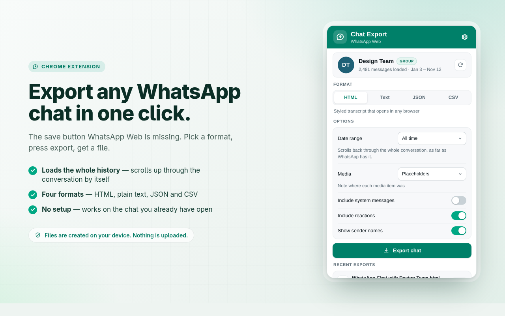
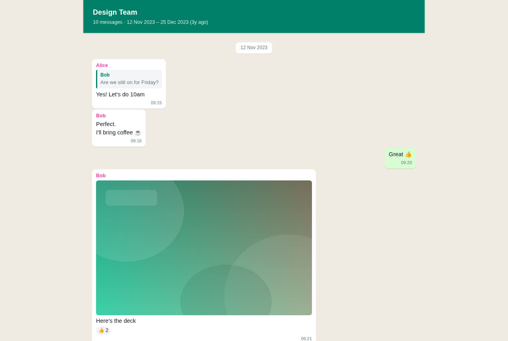

<p align="center">
  
</p>

<h1 align="center">Chat Export for WhatsApp</h1>

<p align="center">
  <b>WhatsApp Web has no save button. This is the save button.</b><br>
  Turn the conversation you have open into an HTML transcript, plain text, structured JSON
  or a spreadsheet-ready CSV — with its photos and documents — without a single byte leaving
  your browser.
</p>

<p align="center">
  <a href="https://github.com/CaullenOmdahl/whatsapp-chat-export/actions/workflows/ci.yml"></a>
  <a href="https://github.com/CaullenOmdahl/whatsapp-chat-export/releases"></a>
  
  
  
</p>

<p align="center">
  
</p>

---

## Why this exists

Your phone can export a chat. WhatsApp Web cannot. If the conversation lives on your laptop —
work threads, a project group, a family chat you want to keep — there is no button that says
"save this", and no official way to get a readable file out of it.

This extension is that button. It reads the conversation you already have open, scrolls back
through its history for you, and writes a clean file to your downloads folder. No account, no
server, no upload, no telemetry, no "sign in with Google". The chat stays between you and your
disk.

> **Not affiliated with, endorsed by, or sponsored by WhatsApp LLC or Meta.** "WhatsApp" is used
> only to describe compatibility with WhatsApp Web. The extension reads the page you have open;
> it never sends, deletes or automates anything.

---

## What you get

| Format | File | Best for | What is inside |
| --- | --- | --- | --- |
| **HTML** | `.html` | Reading and archiving | A styled transcript with chat bubbles, day dividers, avatars' names, quoted replies, reactions and timestamps. One self-contained page: no scripts, no external assets, prints cleanly, dark-mode aware. |
| **Text** | `.txt` | Grep, backups, portability | WhatsApp-like plain text with a header, day dividers and one block per message. Emoji survive; quotes and reactions are indented. |
| **JSON** | `.json` | Scripts, analysis, LLM pipelines | Every message as an object with id, epoch + ISO timestamp, author, direction, type, text, quote, reactions and media metadata, plus conversation statistics. |
| **CSV** | `.csv` | Excel, Sheets, data tools | One row per message, UTF-8 with BOM (so Excel reads emoji correctly), RFC 4180 quoting. |

**Media comes along, optionally.** Set media handling to *Download* and you get a single
`.zip` containing the report and the files it references:

```text
WhatsApp Chat with Design Team - 2026-11-18.zip
├── WhatsApp Chat with Design Team - 2026-11-18.html
└── media/
    ├── 0001-image.jpg
    ├── 0002-voice-note.ogg
    └── 0003-Q4-plan.pdf
```

WhatsApp only exposes media that has been rendered on screen, so anything never loaded in the
chat is exported as a clearly marked placeholder instead of being silently dropped. The
extension tells you how many items were captured and how many were missing.

---

## The file you actually get

<p align="center">
  
</p>

Real generated samples of all four formats live in [`docs/examples/`](docs/examples/) —
[HTML](docs/examples/example-chat.html), [TXT](docs/examples/example-chat.txt),
[JSON](docs/examples/example-chat.json), [CSV](docs/examples/example-chat.csv). Download the
HTML one and open it in a browser to see exactly what you would get.

A few lines of the text output:

```text
WhatsApp Chat with Design Team
Exported 2026-11-18 09:30:00 · 10 messages
Conversation dates: 12 Nov 2023 – 25 Dec 2023
-------------------------------------------------------

--- 12 Nov 2023 ---

[2023-11-12 09:15:00] Alice: Yes! Let's do 10am
    > Bob: Are we still on for Friday?
[2023-11-12 09:16:00] Bob: Perfect.
    I'll bring coffee ☕
[2023-11-12 09:20:00] You: Great 👍
[2023-11-12 09:21:00] Bob: [Photo -> media/0001-image.jpg] Here's the deck
    reactions: 👍 2
```

<details>
<summary><b>Full CSV columns</b></summary>

```text
timestamp_iso, timestamp_ms, date, time, author, direction, type, text,
quoted_author, quoted_text, reactions, media_kind, media_file, media_missing, message_id
```

</details>

<details>
<summary><b>JSON shape</b></summary>

```json
{
  "schema": "chat-export/v1",
  "generator": "Chat Export for WhatsApp 1.0.1",
  "exportedAt": "2026-11-18T02:30:00.000Z",
  "chat": { "name": "Design Team", "isGroup": true },
  "settings": { "format": "json", "mediaMode": "link", "includeSystem": false,
                "includeReactions": true, "dateRange": "all" },
  "stats": { "total": 10, "incoming": 6, "outgoing": 4,
             "byType": { "text": 6, "image": 1, "document": 1, "voice": 1, "deleted": 1 },
             "participants": [ { "name": "Bob", "count": 5 }, { "name": "You", "count": 4 },
                              { "name": "Alice", "count": 1 } ],
             "dateRange": { "start": "2023-11-12T02:15:00.000Z",
                            "end": "2023-12-25T11:02:00.000Z" } },
  "messages": [
    {
      "id": "false_120363000000000000@g.us_AAA1",
      "timestamp": 1699755300000,
      "timestampISO": "2023-11-12T02:15:00.000Z",
      "date": "2023-11-12",
      "time": "09:15:00",
      "author": "Alice",
      "direction": "incoming",
      "type": "text",
      "text": "Yes! Let's do 10am",
      "quoted": { "author": "Bob", "text": "Are we still on for Friday?" },
      "reactions": [],
      "media": null
    }
  ]
}
```

</details>

---

## Install

The extension is not on the Chrome Web Store yet — it is in testing, and store review is the next
step. Installing the unpacked build takes about a minute and works in any Chromium browser.

### Option A — grab a release (easiest)

1. Open **[Releases](https://github.com/CaullenOmdahl/whatsapp-chat-export/releases)** and download
   `whatsapp-chat-export-v1.0.1.zip` from the latest release.
2. Extract it. You should end up with a folder containing `manifest.json`.

### Option B — from source

```bash
git clone https://github.com/CaullenOmdahl/whatsapp-chat-export.git
cd whatsapp-chat-export
```

### Then, either way

1. Open **`chrome://extensions`** (or `edge://extensions`, `brave://extensions`, `arc://extensions`).
2. Turn on **Developer mode** (top-right).
3. Click **Load unpacked** and select the folder that contains `manifest.json` — the extension
   folder itself, not its parent.
4. Pin the extension (puzzle-piece icon → pin) so the button is one click away.
5. Open <https://web.whatsapp.com>, log in by scanning the QR code, and open the chat you want.

Updating later: replace the folder contents (or load the newer release) and press the reload icon
on the extension's card, then reload the WhatsApp tab.

> **Requirements:** Chrome 102+ or a Chromium browser with equivalent Manifest V3 support
> (current Edge, Brave, Arc). A working WhatsApp Web session and the chat open in the active tab.
> There is no build step and no runtime dependency — the extension is plain JavaScript.
> Node.js 22+ is only needed to run the tests and build the release zip.

---

## Use it

1. Click the toolbar icon. The popup shows the chat it detected — name, message count and date
   span.
2. Pick a format, a date range and how to handle media.
3. Press **Export chat**.

The popup shows live progress while it scrolls back through the conversation
(`Loading older messages… 1,240 so far`). **You can close the popup** — the export keeps running
in the WhatsApp tab, and reopening shows the progress again — but keep the WhatsApp tab itself
open and in the foreground.

When it finishes you get a summary: filename, message count, file size and any warnings. The file
is named like `WhatsApp Chat with Alice - 2026-11-18.html`, so a folder of exports stays sortable.
The last five exports are listed in the popup, and an export never interrupts anything you are
doing in WhatsApp — it restores your scroll position when it is done.

### How far back does it go?

**As far as WhatsApp has.** With the date range set to *All time* it keeps loading older pages
until it reaches the first message in the conversation. Pick *Last 30 days* (or a custom range)
and it stops as soon as the start of that range is covered — which is the fast way to export a
slice of a very long chat.

Safety stops exist so a runaway loop cannot wedge the tab: 4,000 scroll rounds, a 10-minute
budget, or 150,000 messages. If one is hit, the export completes and says so in the warnings
instead of pretending it got everything.

---

## Options

| Option | Values | Default | What it does |
| --- | --- | --- | --- |
| **Format** | HTML · Text · JSON · CSV | `HTML` | Output file type. HTML is a standalone styled page; JSON and CSV are for tools. |
| **Date range** | All time · Last 7 / 30 / 90 days · Custom | `All time` | Limits which messages are exported. *All time* scrolls back to the first message; other ranges stop once covered. |
| **Custom range** | start and end date | empty | Used when the range is *Custom*. Both ends inclusive; leave one blank for open-ended. |
| **Media** | None · Placeholders · Download | `Placeholders` | *None* leaves media out; *Placeholders* notes where each item was; *Download* bundles capturable files and the report into one `.zip`. |
| **Size limit** | 10–2048 MB | `250 MB` | Caps media download. Remaining items are marked missing instead of downloaded. Shown when media is *Download*. |
| **Include system messages** | on / off | `off` | Joins, leaves, group changes, encryption and call notices. |
| **Include reactions** | on / off | `on` | Emoji reactions and their counts, attached to the message. |
| **Show sender names** | on / off | `on` | Labels each message with its author. Turn off for a cleaner one-to-one transcript. |

Settings are remembered in `chrome.storage.local`. Nothing is synced anywhere.

---

## Privacy

**The extension has no network code.** Not "we promise not to"; there is no `fetch` for anything
except `blob:`/`data:` URLs that already exist inside the WhatsApp page (that is how media is
captured), and a test fails the build if that changes. No analytics, no error reporting, no remote
config, no remote code.

| Permission | Why it is needed |
| --- | --- |
| `storage` | Remember your options and the list of recent exports. |
| `scripting` | Re-inject the content script if the popup opens before the page finished loading. |
| `activeTab` | Talk to the WhatsApp tab you are looking at, only after you click. |
| `https://web.whatsapp.com/*` | Read the conversation panel. That is the entire surface area. |

**What it never does:** send messages, read your chats in the background, touch other sites, run on
startup, phone home, or store your message content anywhere except the file you download.

The full policy is in [PRIVACY.md](PRIVACY.md). A message body is never written into the document
as HTML unescaped — everything from the page is treated as untrusted text, which is enforced by the
test suite.

---

## How it works

- **A content script runs inside the WhatsApp Web tab**, only on `https://web.whatsapp.com/*`, and
  only after you ask it to. It reads the already-rendered page; it has no network access.
- **The conversation is scraped structurally, not by class name.** WhatsApp rotates obfuscated
  class names constantly, so the scraper keys off stable facts: `#main`, `div[data-id]` message
  ids, the `data-pre-plain-text` timestamp/author attribute, and `.selectable-text` bodies. Every
  lookup has a fallback chain, and a miss becomes a warning rather than a failed export.
- **History is loaded page by page.** It scrolls to the top to make WhatsApp fetch older messages,
  waits for the page to render, and parses only what it has not seen yet. When a jump stops
  producing pages it switches to viewport-sized scroll steps before concluding the chat is fully
  loaded. Messages are kept as they are seen, so ones WhatsApp removes from the DOM mid-scroll
  still reach the file.
- **Timestamps are parsed per locale.** WhatsApp renders dates differently in every language, and
  the day/month order is inferred from the conversation itself, not assumed.
- **Everything is normalised into one message model** (author, direction, type, text, quote,
  reactions, media), so all four formats come from a single parse.
- **Files are built in the browser** as a `Blob` and saved through an object URL. The ZIP container
  is written by hand — no dependencies, and CRCs are validated in the tests.

More detail, including the selector strategy and failure modes, is in
[docs/ARCHITECTURE.md](docs/ARCHITECTURE.md). The popup ↔ content-script contract is in
[docs/PROTOCOL.md](docs/PROTOCOL.md).

---

## FAQ

<details>
<summary><b>Do I need my phone?</b></summary>

No. If WhatsApp Web is logged in, the extension works. It uses the session that is already open.
</details>

<details>
<summary><b>Does it work on WhatsApp Desktop, or with my whole chat list at once?</b></summary>

No and not yet. It exports the conversation currently open in the WhatsApp Web tab. A batch
"export everything" mode is the most requested idea — see the issue tracker.
</details>

<details>
<summary><b>Where do the files go?</b></summary>

Your browser's normal Downloads folder. Nothing is uploaded anywhere.
</details>

<details>
<summary><b>Why are some photos missing from the archive?</b></summary>

WhatsApp only keeps a downloadable copy of media that has been rendered on screen. A photo you
have never scrolled past has no bytes in the page, so it cannot be captured. It is exported as a
placeholder marked *not loaded in WhatsApp*. Scroll through the chat once before exporting if you
need those files.
</details>

<details>
<summary><b>Why did a very long chat stop before the beginning?</b></summary>

Either the safety cap was reached (the result panel says which), or WhatsApp stopped serving older
pages. Use a date range to export it in slices — that is faster and bounded. Details in
[docs/TROUBLESHOOTING.md](docs/TROUBLESHOOTING.md).
</details>

<details>
<summary><b>Does it work in Edge, Brave, Arc or Chromium?</b></summary>

Yes. It is a standard Manifest V3 extension; the unpacked install steps are identical.
</details>

<details>
<summary><b>Can it export a chat I am not part of?</b></summary>

No. It reads only the conversation open in your logged-in session — the same thing you can
already see on screen.
</details>

<details>
<summary><b>Is it affiliated with WhatsApp or Meta?</b></summary>

No. It is an independent open-source tool, MIT licensed, and not endorsed by or connected to
WhatsApp LLC or Meta. "WhatsApp" is used only to say what it is compatible with.
</details>

---

## Troubleshooting

If something looks wrong, the popup's **Diagnostics** panel lists every page selector it relies on,
how many elements matched, the rendered message count, whether the scroll container was found and
any warnings — with a one-click **Copy report**. That turns "it broke" into a useful bug report.

Start with [docs/TROUBLESHOOTING.md](docs/TROUBLESHOOTING.md). The usual suspects: WhatsApp is still
loading, the chat is not open, or WhatsApp shipped a markup change that needs a selector update.

---

## Development

No bundler, no framework, no runtime dependencies: classic scripts on one `WAEx` namespace, plus
`jsdom` for tests.

```bash
npm ci                # install the one dev dependency
npm test              # 7 suites
npm run lint          # permissions, no-network, no-innerHTML, manifest contract, version sync
npm run build         # dist/whatsapp-chat-export-v1.0.1.zip, ready for the Web Store
```

| Script | What it does |
| --- | --- |
| `npm run test:<suite>` | Run one suite (`manifest`, `datetime`, `formats`, `zip`, `extractor`, `e2e`, `popup`) |
| `npm run screenshots` | Regenerate the 26 popup screenshots in `test/screenshots/` |
| `npm run store-shots` | Regenerate the 1280×800 Web Store artwork in `docs/store/` |
| `npm run examples` | Regenerate the sample exports in `docs/examples/` |
| `npm run smoke:chrome` | Load the unpacked extension in real headless Chrome and check it boots |

**What the tests cover:** locale-tolerant date parsing, all four writers (including HTML escaping
and CSV quoting), the hand-written ZIP container (validated with Python's `zipfile`), the scraper
against a simulated WhatsApp DOM, an end-to-end export whose downloaded file is opened and checked,
the real popup wired to the real content script, and the manifest/packaging rules. CI runs the
suite on Node 22 and 24, builds the store zip, and tags publish a release automatically.

Contributor docs: [CONTRIBUTING.md](CONTRIBUTING.md) · [docs/ARCHITECTURE.md](docs/ARCHITECTURE.md) ·
[docs/PROTOCOL.md](docs/PROTOCOL.md) · [docs/RELEASING.md](docs/RELEASING.md) ·
[docs/STORE.md](docs/STORE.md).

---

## Contributing, security and support

- **Contributing:** [CONTRIBUTING.md](CONTRIBUTING.md) — dev setup, the ground rules (no network,
  no new permissions, no `innerHTML` with user content), and what is most useful in a pull request.
- **Questions and ideas:** [GitHub Discussions](https://github.com/CaullenOmdahl/whatsapp-chat-export/discussions).
- **Bugs:** use the issue form and paste the Diagnostics report — it contains selector match counts,
  no message content.
- **Security:** report privately via [SECURITY.md](SECURITY.md). Please do not open a public issue
  for a vulnerability.
- **Code of conduct:** [CODE_OF_CONDUCT.md](CODE_OF_CONDUCT.md).

The most valuable bug report is a **broken selector** after a WhatsApp update: include the
Diagnostics report and, if you can, a snippet of the new markup with message content redacted.

---

## License

[MIT](LICENSE) © 2026 Chat Export for WhatsApp contributors. Use it, fork it, ship it, learn from it.

> **Trademark note.** Chat Export for WhatsApp is not affiliated with, endorsed by, or sponsored by
> WhatsApp LLC or Meta. "WhatsApp" is a trademark of Meta Platforms, Inc. and is used only to
> describe compatibility with WhatsApp Web. The extension only reads the conversation you have open
> and never automates WhatsApp actions.
